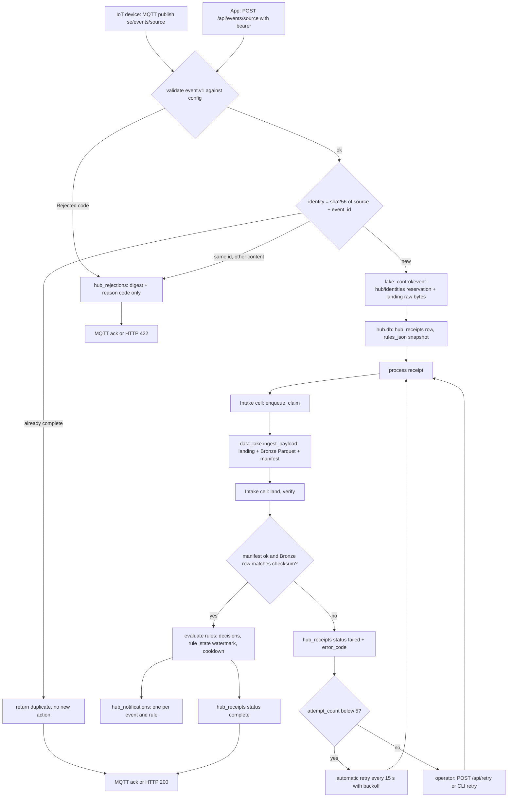
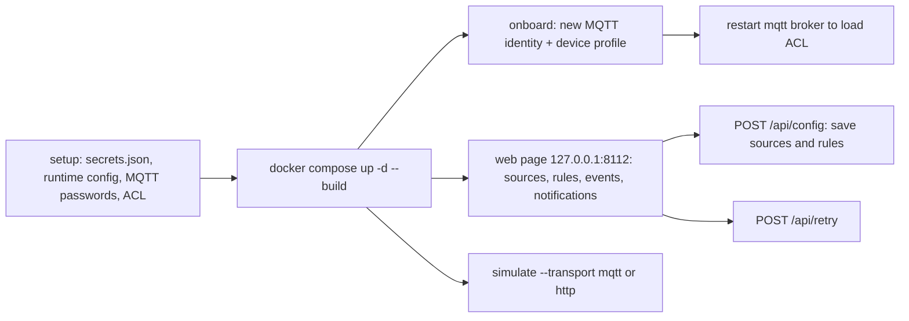
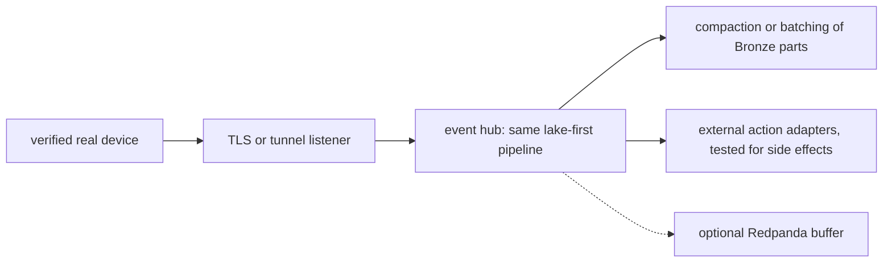

# 01 — Business process (As-Is / To-Be)

ระบบนี้คือ **local pilot** ของ Event Hub: รับค่าตัวเลข (telemetry) จากอุปกรณ์ผ่าน MQTT และจากแอปผ่าน HTTP,
เก็บ exact bytes ลง data lake, ตรวจ Bronze ให้ผ่านก่อน แล้วจึงประเมิน threshold rule เพื่อสร้าง internal notification
(ไม่มี external action). ไม่ได้ deploy แบบ hosted: registry ระบุ `host: local`, `status: exception`.

## As-Is (จากโค้ดวันนี้)

Sources: `infra/scripts/services/event_hub.py` (`validate`, `Hub.receive`, `Hub.process`, `Hub.evaluate`, `Hub.retry`),
`infra/scripts/services/event_hub_transport.py` (`MQTTWorker.on_message`, `handler_for.do_POST`, `run.Server.service_actions`),
`infra/scripts/cli/data-intake-cli.py`, `infra/scripts/data_lake/ingest.py`, `PRODUCT.md`, `infra/event-hub/README.md`.

### งานของ operator (As-Is)

Sources: `infra/event-hub/README.md`, `infra/scripts/services/event_hub_transport.py` (`setup`, `onboard`, `simulate`), `infra/event-hub/index.html`.

## To-Be (จากเอกสารของ repo เท่านั้น)

ไม่มี `docs/UPGRADE-PLAN.md`; To-Be ต่อไปนี้มาจาก `infra/event-hub/README.md` ส่วน "ขอบเขต pilot และขั้นถัดไป",
`PRODUCT.md` และ `DOCPACK/00-product-card.md` §8:

- ระบุ use case จริงอย่างน้อยหนึ่งรายการ และยืนยันอุปกรณ์จริง (รุ่น/เครือข่าย) — product card §8, PRODUCT.md `[ต้องยืนยัน]`
- เชื่อมจาก LAN ผ่าน tunnel หรือ listener ที่มี TLS/ACL ก่อนเปิดใช้งาน (README)
- เพิ่ม compaction/batching ก่อนใช้ข้อมูลถี่ (README: ตอนนี้ Parquet part ต่อ event)
- action adapter สำหรับข้อความภายนอก / actuator / API ภายนอก (README; PRODUCT.md ระบุว่า out of scope ตอนนี้)
- Redpanda เป็นทางเลือกในอนาคตเมื่อต้อง buffering/fan-out (README)

Sources: `infra/event-hub/README.md`, `PRODUCT.md`, `DOCPACK/00-product-card.md`.

## Open questions

- ใครใช้ pilot อยู่จริงวันนี้ และอุปกรณ์ใด (PRODUCT.md `[ต้องยืนยัน]`; registry data-sources: "confirm which devices still post")
- To-Be ข้างบนมีลำดับความสำคัญหรือวันที่หรือไม่ — ไม่มี roadmap ใน repo
