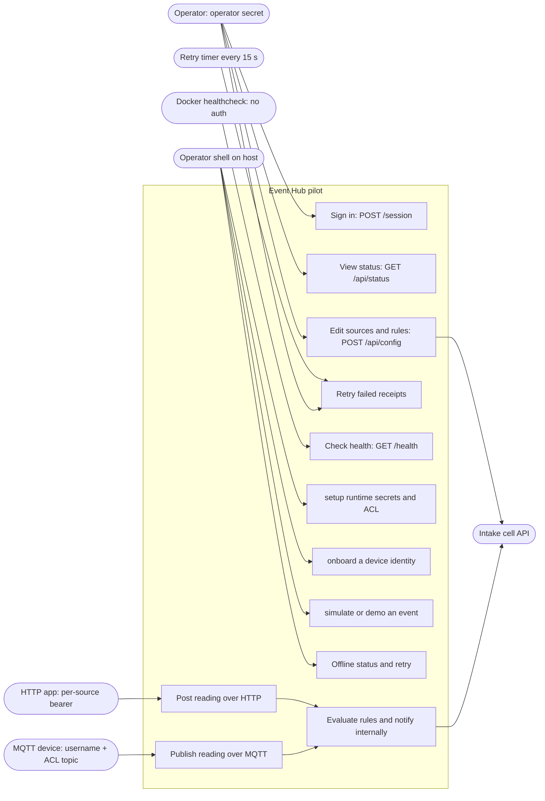

# 02 — Use cases

Actors คือ auth level จริงในโค้ด: operator secret (`values["operator"]`), MQTT username/password ต่อ source,
HTTP bearer token ต่อ source, และ caller ที่ไม่ต้อง auth (`/health`, จำกัดด้วย local `Host`/`Origin`).

| Actor | Auth ในโค้ด | Use cases |
|---|---|---|
| Operator (web) | bearer หรือ cookie `hub_session` เทียบ `hmac.compare_digest` กับ operator secret | UC1–UC4 |
| Operator shell | สิทธิ์ไฟล์ `.runtime` (0600) บน host | UC8–UC11 (`setup`, `onboard`, `simulate`, `demo`, `status`, `retry`) |
| MQTT device | Mosquitto password file + ACL `topic write se/events/<source>` | UC5 |
| HTTP app | bearer ต่อ source ใน `secrets.json` `http` | UC6 |
| Docker healthcheck | ไม่มี; ต้องเป็น local Host | UC7 |
| Retry timer | in-process (`Server.service_actions`) | UC4 อัตโนมัติ |
| Intake cell API | hub เรียกออกด้วย automation token `event-hub` | ถูกเรียกใน UC12, UC3 (`sync_sources`) |

Sources: `infra/scripts/services/event_hub_transport.py`, `infra/scripts/services/event_hub.py` (`main`), `infra/event-hub/compose.yml`,
`infra/event-hub/mosquitto.acl`, `infra/scripts/utils/cell_store.py`, `PRODUCT.md`.

## Open questions

- มี HTTP app จริงนอกจาก `app-demo` หรือไม่ (config ที่ ship มีแค่ `sensor-demo` และ `app-demo`)
