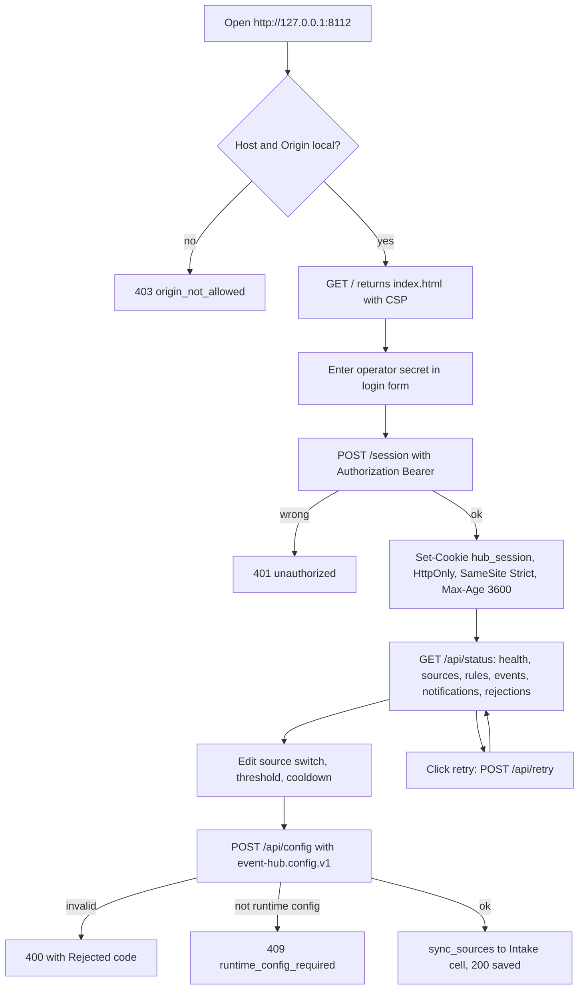
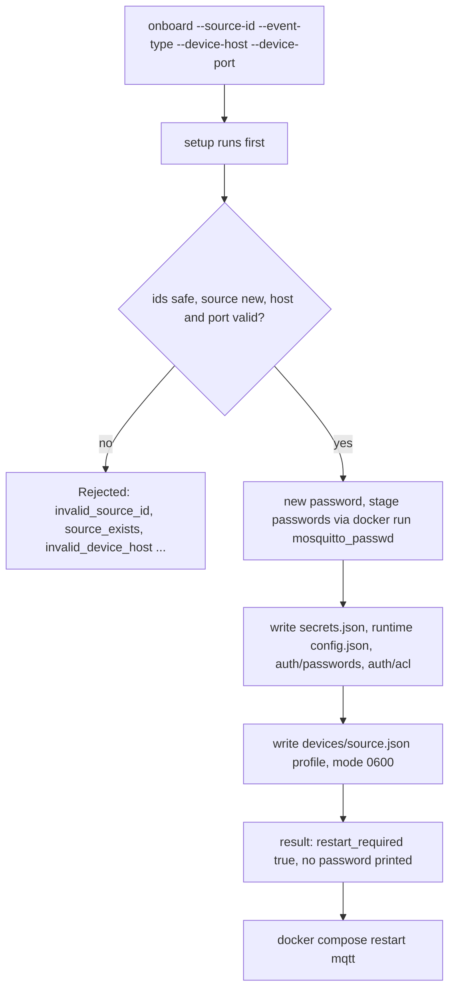
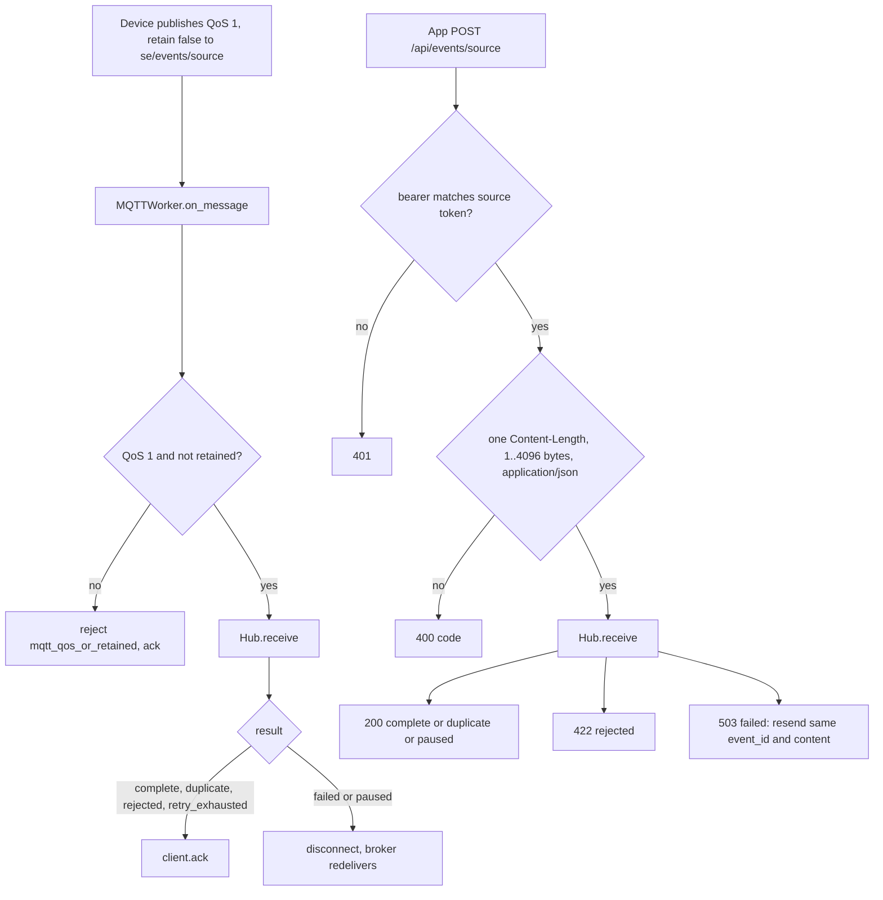

# 03 — User flows

## Operator: เข้าหน้าเว็บและจัดการกฎ

Sources: `infra/event-hub/index.html`, `infra/scripts/services/event_hub_transport.py` (`get_response`, `do_POST`, `local_origin`, `operator`).

## Operator shell: onboarding อุปกรณ์

Sources: `infra/scripts/services/event_hub_transport.py` (`onboard`, `_password_stage`, `write_acl`, `write_private_json`), `infra/event-hub/README.md`.

## Device / app: ส่งค่า

Sources: `infra/scripts/services/event_hub_transport.py` (`MQTTWorker.on_message`, `handler_for.body`, `do_POST`), `infra/event-hub/README.md`.

## Open questions

- `paused` ใน HTTP คืน 200 (ไม่ใช่ 503) ทั้งที่ยังไม่ complete — ตั้งใจหรือไม่ (โค้ด map เฉพาะ `rejected`→422, `failed`→503)
