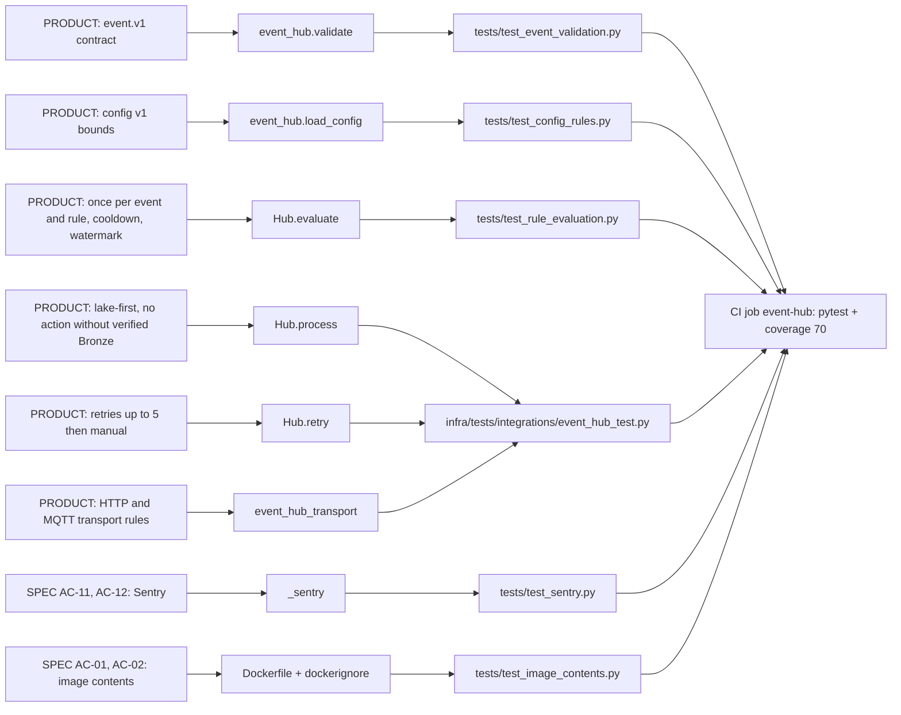

# 04 — Traceability (RTM)

Requirement มาจาก `PRODUCT.md` (Capabilities and Constraints) และ `specs/001-l2-baseline/spec.md` (AC-01..AC-12).
"Release" ของ repo นี้คือ CI workflow `CI` (job `event-hub` + `security`) — ไม่มี deploy workflow (local pilot).

| Req | Requirement | Code | Test | Release / workflow |
|---|---|---|---|---|
| P-1 | event.v1 exact fields, ≤4096 bytes, finite value + unit, tz timestamp | `infra/scripts/services/event_hub.py` `validate`, `timestamp`, `json_object` | `tests/test_event_validation.py` (AC-03..AC-06) | `.github/workflows/ci.yml` job `event-hub` |
| P-2 | config v1: 1–100 sources, ≤100 rules, ops gt/gte/lt/lte/eq, window 0–604800, only `internal_notification` | `event_hub.py` `load_config` | `tests/test_config_rules.py` (AC-07, AC-08) | `event-hub` |
| P-3 | one notification per event + rule, cooldown, late / stale_or_future / unit_mismatch | `Hub.evaluate`, `hub_notifications UNIQUE(identity, rule_id)` | `tests/test_rule_evaluation.py` (AC-09, AC-10), `event_hub_test.py::test_normal_threshold_cooldown_and_late_order` | `event-hub` |
| P-4 | lake-first: action only after verified Bronze; crash/lake failure never notifies | `Hub.process`, `intake.verify_manifest` | `event_hub_test.py::test_lake_failure_blocks_actions_then_restart_recovers`, `::test_tampered_bronze_never_projects`, `::test_action_failure_rolls_back_cooldown_and_notifications` | `event-hub` |
| P-5 | dedup by `(source_id, event_id)`, conflicting content rejected | `Hub.receive` | `event_hub_test.py::test_duplicate_whitespace_and_conflicting_identity` | `event-hub` |
| P-6 | retries: auto backoff up to 5, then manual | `Hub.retry(automatic=True)`, `Server.service_actions` | `event_hub_test.py::test_automatic_retry_is_bounded_and_manual_retry_recovers` | `event-hub` |
| P-7 | rejected payloads leave only digest + code | `Hub.reject` | `event_hub_test.py::test_untrusted_shapes_rejected_without_raw_storage` | `event-hub` |
| P-8 | HTTP auth per source, local Host/Origin, operator endpoints | `handler_for` | `event_hub_test.py::test_http_auth_origin_validation_and_config` | `event-hub` |
| P-9 | MQTT ack only after complete / duplicate / rejected / exhausted | `MQTTWorker.on_message` | `event_hub_test.py::test_mqtt_ack_only_after_completion_or_visible_rejection` | `event-hub` |
| P-10 | onboarding: scoped identity, ACL, private profile, no secret printed | `onboard`, `write_acl` | `event_hub_test.py::test_onboard_*` (3 tests) | `event-hub` |
| P-11 | single writer per runtime | `Hub.__init__` `fcntl.flock` | `event_hub_test.py::test_single_runtime_writer` | `event-hub` |
| P-12 | Intake source registry / queue lifecycle | `infra/scripts/cli/data-intake-cli.py` | `infra/tests/integrations/data_intake_test.py` | `event-hub` (`test-command` second part) |
| AC-01, AC-02 | image imports hub; COPY sources pass dockerignore | `infra/event-hub/Dockerfile`, `Dockerfile.dockerignore` | `tests/test_image_contents.py` | `event-hub` |
| AC-11, AC-12 | Sentry opt-in, scrubbed, only unexpected errors | `infra/scripts/services/_sentry.py`, `Hub.process` `capture` | `tests/test_sentry.py` | `event-hub` |
| P-13 | MQTT + HTTP end to end on the compose stack | whole stack | `infra/tests/integrations/event_hub_live_test.py` | **manual only** (not in CI) |
| L1 | locked deps, hash-pinned image install | `uv.lock`, `infra/event-hub/requirements.lock` | CI install `uv sync --frozen`; OSV-Scanner | `security` job |

Sources: `PRODUCT.md`, `specs/001-l2-baseline/spec.md`, `pyproject.toml` (`testpaths`), `.github/workflows/ci.yml`, ไฟล์ทดสอบที่ระบุ.

## Gaps

- P-13 (live E2E) ไม่อยู่ใน CI; ผลอยู่ใน `.runtime/live-evidence.json` ส่วนตัว
- PRODUCT.md Measures "Time from receipt to complete" ไม่มีโค้ดวัด (`[ต้องยืนยัน]` ใน PRODUCT.md)
- SPEC-001 review 2026-10-24: §4 Interfaces table เสีย (แถวตัวอักษรเดียว) และ AC-01 อ้าง test ผิดตัว (`--help` อยู่ใน `test_the_image_command_parses_its_arguments`) — ยังไม่แก้

## Open questions

- SPEC-001 ยัง "pending owner" approval
