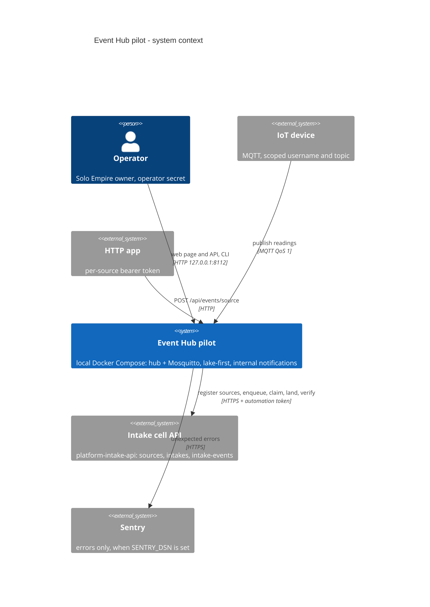

# 05 — C4 Context

- Intake cell: hub เรียกผ่าน `open_cell_store("intake", "event-hub")` → URL จาก `EMPIRE_INTAKE_API` (env หรือ `~/.config/empire-platform/client.env`).
  บนเครื่อง owner ค่านี้ชี้ `https://gateway.bookchaowalit.com/v1/intake` (ops record: api-gateway-edge (2026-11-03)).
- Registry: `event-hub` = `host: local`, `status: exception` (solo-empire `repository-catalog/registries/online-systems.yaml`).

Sources: `infra/scripts/services/event_hub.py` (`Hub.__init__`, `AUTOMATION_ID`), `infra/scripts/utils/cell_store.py`, `infra/scripts/services/_sentry.py`,
`infra/event-hub/compose.yml`, `PRODUCT.md`, ops record: api-gateway-edge (2026-11-03).

## Open questions

- compose ไม่ส่ง `EMPIRE_INTAKE_API` / `EMPIRE_AUTOMATION_TOKEN_EVENT_HUB` เข้า container `hub` และไม่ mount `.runtime/automation-tokens` ของ repo root —
  container path ต่อ Intake cell ได้จริงหรือไม่ (ดู 16-deployment)
