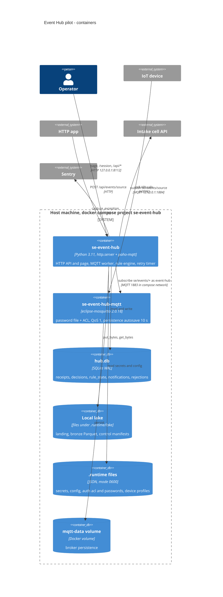

# 06 — C4 Container

Sources: `infra/event-hub/compose.yml`, `infra/event-hub/Dockerfile`, `infra/event-hub/mosquitto.conf`, `infra/event-hub/start-mqtt.sh`,
`infra/scripts/services/event_hub.py` (`HUB_SCHEMA`, `Hub.__init__`), `infra/scripts/services/event_hub_transport.py` (`run`, `MQTTWorker`).

หมายเหตุ: host mode (`event_hub.py serve` บน host + broker ใน compose) ใช้ runtime เดียวกันได้ แต่ห้ามรันพร้อม container worker; `fcntl.flock` บน `hub.lock` กันไว้ (`infra/event-hub/README.md`).
