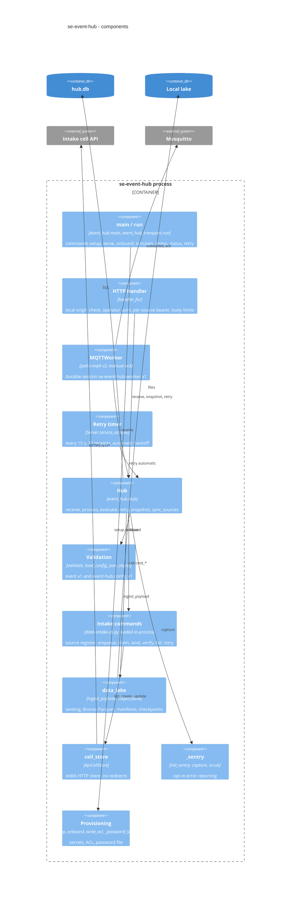

# 07 — C4 Component (se-event-hub)

Sources: `infra/scripts/services/event_hub.py`, `infra/scripts/services/event_hub_transport.py`, `infra/scripts/services/_sentry.py`,
`infra/scripts/cli/data-intake-cli.py`, `infra/scripts/utils/cell_store.py`, `infra/scripts/data_lake/ingest.py`, `infra/scripts/data_lake/storage.py`.

หมายเหตุ: `utils/*` และ `data_lake/*` เป็น vendored copies (README; `pyproject.toml` mypy exclude) — ต้นฉบับอยู่ที่ solo-empire / data-lake.
