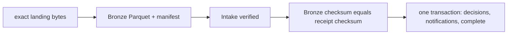

# ADR-0001 — Lake-first: verified Bronze before any action

- Status: accepted (retro-documented)
- Date: retro-documented 2026-11-04 (behaviour present since the pilot, `infra/event-hub/README.md` created 2026-09-08)

## Context
Events มาจากอุปกรณ์/แอปที่อาจส่งซ้ำ, crash ระหว่างทาง, หรือ lake เขียนไม่สำเร็จ. ต้องไม่มี notification ที่ไม่มีหลักฐานใน lake.

## Decision
ทุก event ผ่าน: identity reservation + exact landing bytes → Intake `enqueue/claim` → `ingest_payload` (landing + Bronze Parquet + manifest) →
Intake `land/verify` → `verify_manifest` → อ่าน Bronze row แล้วเทียบ canonical checksum → จึง `evaluate` rules,
บันทึก decisions / rule_state / notifications และ `status='complete'` ใน SQLite transaction เดียว.

## Evidence
- `infra/scripts/services/event_hub.py` `Hub.process` (raises `intake_not_verified`, `bronze_count_mismatch`, `bronze_identity_mismatch`; `self.conn.rollback()` on any exception)
- `infra/tests/integrations/event_hub_test.py::test_lake_failure_blocks_actions_then_restart_recovers`, `::test_tampered_bronze_never_projects`, `::test_action_failure_rolls_back_cooldown_and_notifications`
- `PRODUCT.md` Product Purpose; central spec [event-hub-ingestion-spec.md](https://github.com/bookchaowalit/architecture-docs/blob/main/systems/ai-data/event-hub-ingestion-spec.md)

## Consequences
- ปลอดภัยต่อ duplicate และ crash; latency สูงขึ้น (หลาย round trip ไป Intake cell ต่อ event)
- Parquet part ต่อ event — ต้อง compaction ก่อนใช้ข้อมูลถี่ (README)
