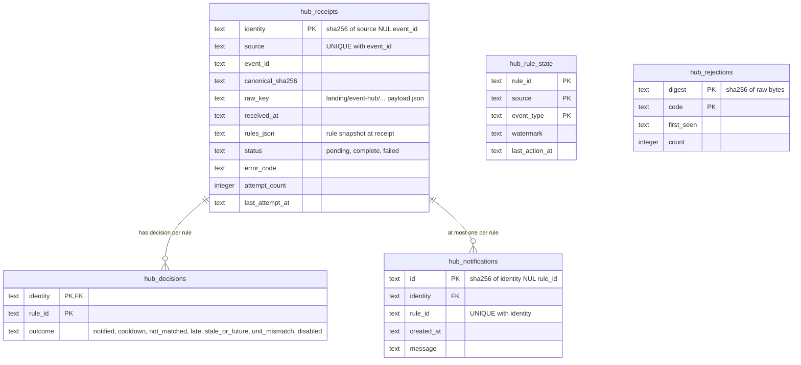
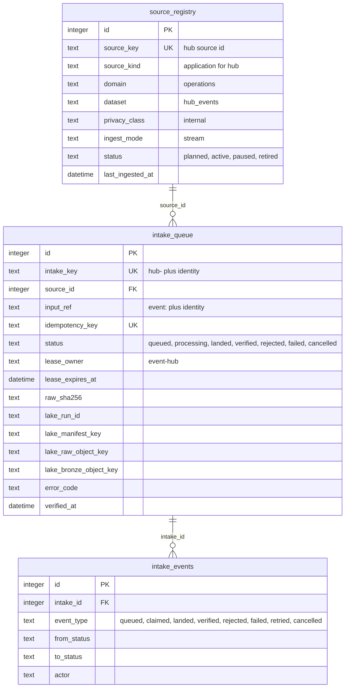

# 09 — ERD

ข้อมูลที่ persist มี 3 ที่: (1) `hub.db` SQLite ของ hub, (2) Intake cell (hosted) — โครงสร้างตาม migration ที่ vendored ไว้,
(3) local lake (object keys). `infra/database/schema.sql` เป็น fixture ของ solo-empire DB สำหรับ test doubles เท่านั้น (ไม่ใช่ข้อมูลของ hub).

## hub.db (owned by this repo)

Sources: `infra/scripts/services/event_hub.py` (`HUB_SCHEMA`, `Hub.__init__` column migration, `Hub.evaluate`, `Hub.reject`).

## Intake cell (external, schema per vendored migration 033)

ความสัมพันธ์ข้าม store (logical, ไม่มี FK): `intake_queue.intake_key = "hub-" + hub_receipts.identity`; `source_registry.source_key = hub_receipts.source`.

Sources: `infra/database/migrations/033_source_registry_intake_queue.sql`, `infra/scripts/cli/data-intake-cli.py` (resources `sources`, `intakes`, `intake-events`),
`infra/scripts/services/event_hub.py` (`sync_sources`, `process`).

## Local lake object keys

| Key pattern | Written by | Content |
|---|---|---|
| `control/event-hub/identities/<identity>.json` | `Hub.receive` | `{"sha256": canonical checksum}` reservation (immutable) |
| `landing/event-hub/source=<s>/event=<identity>/payload.json` | `Hub.receive` | exact first request bytes (recovery copy) |
| `landing/source=<s>/batch_id=<id>/payload.json` | `ingest_payload` | exact bytes, shared landing contract |
| `bronze/domain=operations/dataset=hub_events/schema_version=1/ingest_date=<d>/source=<s>/part-<id>.parquet` | `ingest_payload` | one-row Bronze envelope (`payload_json`) |
| `control/manifests/source=<s>/batch_id=<id>.json` | `ingest_payload` | raw + Bronze sha256, lineage |
| `control/checkpoints/source=<s>/batch_id=<id>.json` | `ingest_payload` | resume point for partial writes |

Sources: `infra/scripts/services/event_hub.py`, `infra/scripts/data_lake/ingest.py`, `infra/scripts/data_lake/storage.py`.

## Runtime files (`infra/event-hub/.runtime/`, gitignored)

`secrets.json` (mqtt / http / operator), `config.json`, `auth/acl`, `auth/passwords`, `devices/<source>.json`, `hub.db`, `hub.lock`, `lake/`, `live-evidence.json`.

Sources: `infra/scripts/services/event_hub_transport.py`, `infra/event-hub/.gitignore`, `infra/event-hub/README.md`.

## Open questions

- schema จริงของ Intake cell อยู่ใน platform-intake-api; migration 033 ที่ vendored ไว้ยังตรงกับ hosted schema หรือไม่ (cell มี `version` ที่ `guarded_update` ใช้ แต่ไม่มีใน 033)
