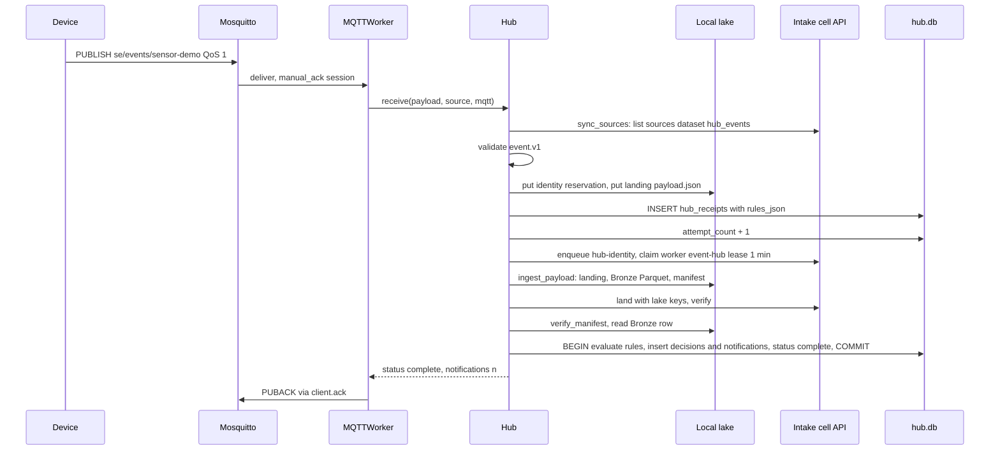
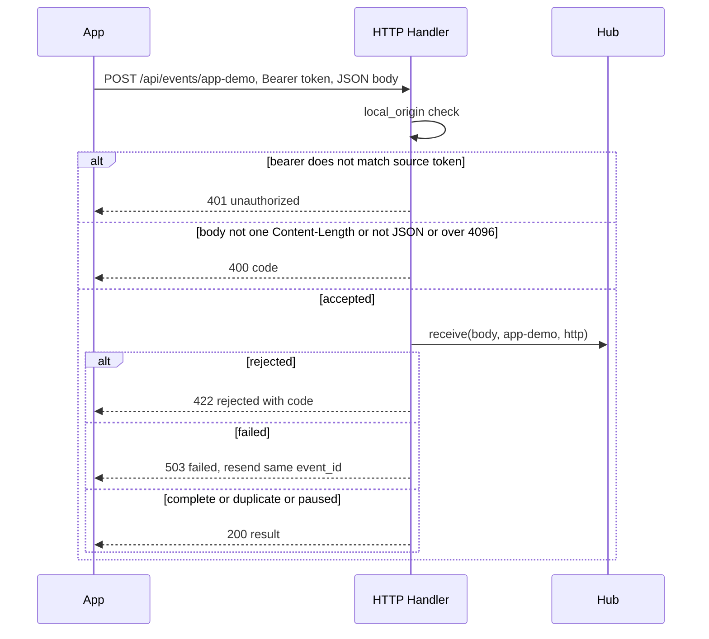
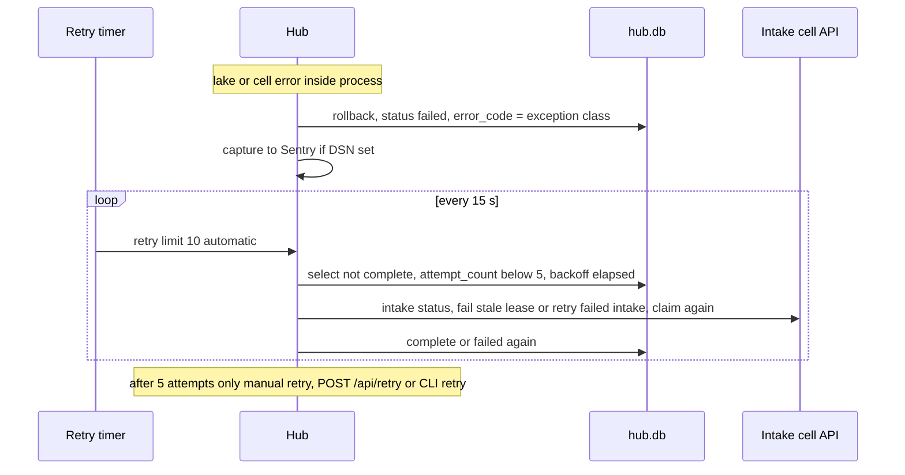
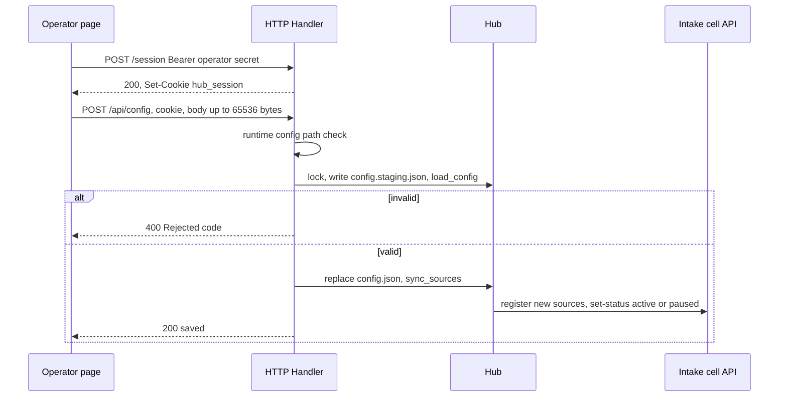

# 10 — Sequences

## 1. MQTT reading → complete → ack

## 2. HTTP reading with per-source bearer

## 3. Failure then automatic retry

## 4. Operator saves config

Sources: `infra/scripts/services/event_hub.py` (`receive`, `process`, `evaluate`, `retry`, `sync_sources`),
`infra/scripts/services/event_hub_transport.py` (`MQTTWorker`, `handler_for`, `run`), `infra/scripts/cli/data-intake-cli.py`, `infra/event-hub/index.html`.
