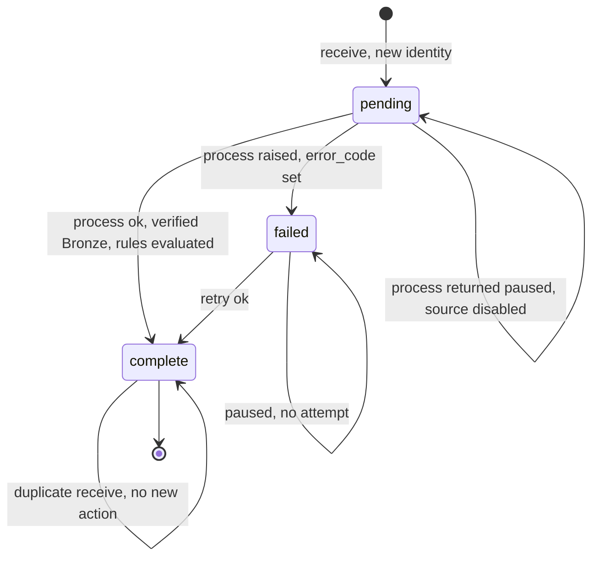
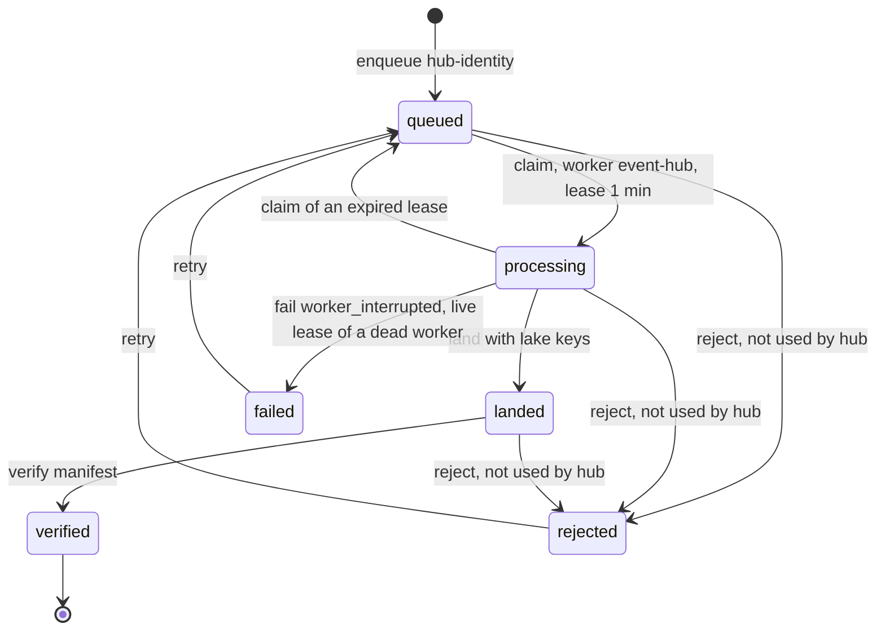
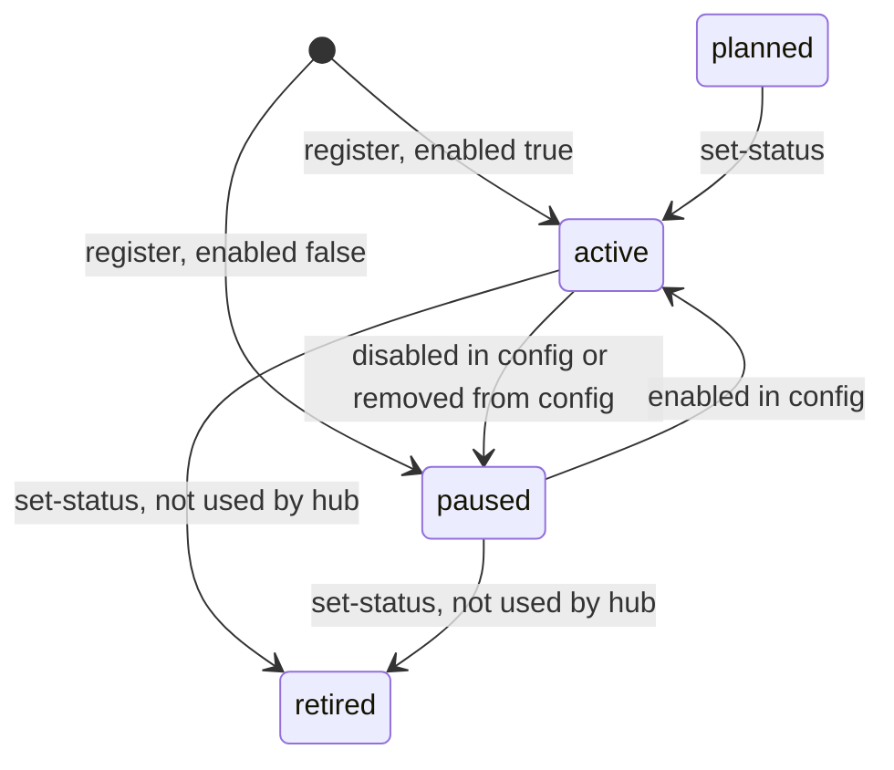
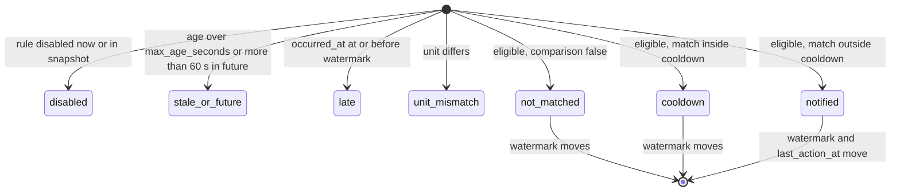
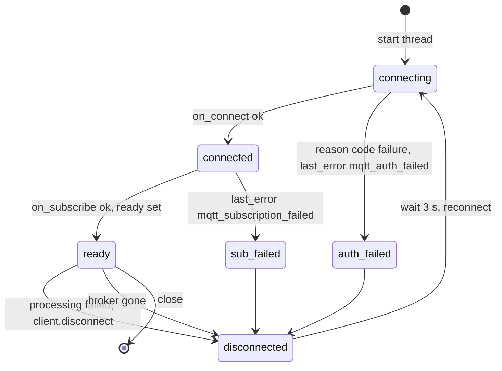

# 11 — State machines

## hub_receipts.status

- Automatic retry เลือกเฉพาะ `status != 'complete' AND attempt_count < 5` และ backoff `min(300, 15 * 2^(attempt_count-1))` วินาที; หลังจากนั้น `receive` ของ event เดิมคืน `retry_exhausted` และต้องสั่ง manual retry (`Hub.retry()` ไม่มีเงื่อนไข attempt).

Sources: `infra/scripts/services/event_hub.py` (`HUB_SCHEMA`, `receive`, `process`, `retry`).

## Intake cell intake status (as driven by the hub)

Sources: `infra/scripts/cli/data-intake-cli.py` (`QUEUE_STATUSES`, `cmd_claim`, `cmd_land`, `cmd_verify`, `cmd_fail`, `cmd_retry`, `cmd_reject`),
`infra/scripts/services/event_hub.py` (`process`), `infra/database/migrations/033_source_registry_intake_queue.sql`.

## Source status in the Intake cell (hub sync)

Sources: `infra/scripts/services/event_hub.py` (`sync_sources`), `infra/scripts/cli/data-intake-cli.py` (`SOURCE_STATUSES`, `cmd_source_set_status`).

## Rule decision outcome per (event, rule)

Sources: `infra/scripts/services/event_hub.py` (`evaluate`), `tests/test_rule_evaluation.py`.

## MQTTWorker connection

Sources: `infra/scripts/services/event_hub_transport.py` (`MQTTWorker`). `/health` = 503 เมื่อไม่ `ready` หรือมี `last_error`.
