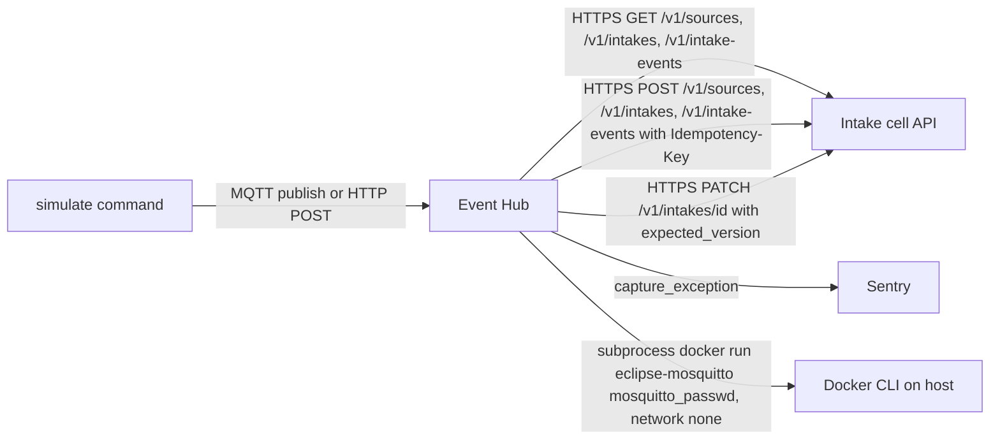

# 12 — API & integrations

## Inbound HTTP (`127.0.0.1:8112`, `http.server.HTTPServer`, socket timeout 5 s)

ทุก request ต้องมี `Host` = `127.0.0.1:<port>` หรือ `localhost:<port>` และ `Origin` (ถ้ามี) ตรงกัน มิฉะนั้น 403 `origin_not_allowed`.

| Method + path | Auth | Request | Responses |
|---|---|---|---|
| `GET /` | none | — | 200 `index.html` + CSP `default-src 'self'`, `frame-ancestors 'none'` |
| `GET /health` | none | — | 200 `healthy` / 503 `degraded` (MQTT ready, no `last_error`, snapshot healthy) |
| `GET /api/status` | operator | — | 200 snapshot: counts, sources, rules, last 50 events (value/unit from Bronze), last 50 notifications, rejection counts, `mqtt_connected`; 401 |
| `POST /session` | operator bearer | — | 200 + `Set-Cookie hub_session=...; HttpOnly; SameSite=Strict; Path=/; Max-Age=3600`; 401 |
| `POST /api/events/<source>` | per-source bearer (`secrets.json` `http`) | `application/json`, one `Content-Length`, 1–4096 bytes, no `Transfer-Encoding` | 200 complete/duplicate/paused, 422 rejected, 503 failed, 400 body code, 401 |
| `POST /api/retry` | operator | — | 200 `{"results": [...]}` (up to 100 receipts) |
| `POST /api/config` | operator | `event-hub.config.v1`, ≤65536 bytes | 200 `saved`, 400 Rejected code, 409 `runtime_config_required` |
| other | — | — | 404 `not_found`; unexpected error 503 `status_unavailable` / `processing_unavailable` |

Response headers: `Content-Type: application/json`, `Cache-Control: no-store`, `X-Content-Type-Options: nosniff`.

## Inbound MQTT

| Item | Value |
|---|---|
| Broker | Mosquitto 2.0.18, `allow_anonymous false`, `max_qos 1`, `retain_available false`, `message_size_limit 4096` |
| Topic | `se/events/<source>` (device: `topic write`; worker `event-hub`: `topic read se/events/+`) |
| Worker session | client id `se-event-hub-worker-v1`, `clean_session=False`, `manual_ack=True`, MQTT v3.1.1, keepalive 30 |
| Ack rule | ack on `complete`, `duplicate`, `rejected`, or `retry_exhausted`; otherwise disconnect for redelivery |

## Outbound integrations

| Integration | How | Auth | Notes |
|---|---|---|---|
| Intake cell API | `ApiCellStore` (stdlib `urllib`, no redirects, timeout 30 s) | `Authorization: Bearer` automation token `event-hub` (`EMPIRE_AUTOMATION_TOKEN_EVENT_HUB` or `<root>/.runtime/automation-tokens/event-hub.jwt` or `~/.config/empire-platform/tokens/`) + `X-Empire-Channel: workflow` + `X-Correlation-Id` | URL `EMPIRE_INTAKE_API`, https only (http for loopback) |
| Sentry | `sentry_sdk.capture_exception` | DSN env | errors only, scrubbed |
| Docker CLI | `subprocess.run([... "mosquitto_passwd", "-U" ...])` in `setup` / `onboard` | host docker | hashes password file offline |

Sources: `infra/scripts/services/event_hub_transport.py`, `infra/scripts/utils/cell_store.py`, `infra/scripts/utils/task_store.py` (`automation_token`, `token_dirs`),
`infra/scripts/cli/data-intake-cli.py`, `infra/event-hub/mosquitto.conf`, `infra/event-hub/mosquitto.acl`, `infra/scripts/services/_sentry.py`.

## Open questions

- automation `event-hub` มี grant `intake.*` ใน identity/empire-platform หรือไม่ (ไม่มีหลักฐานใน repo หรือ ops records)
