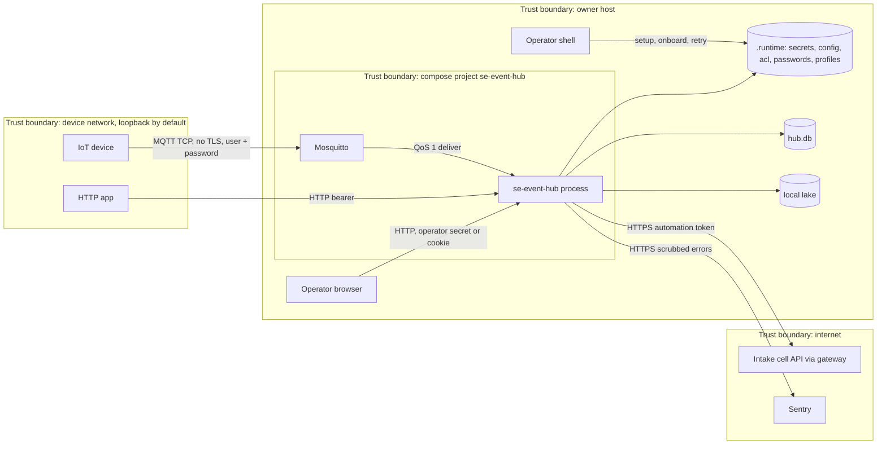

# 13 — Threat model (DFD + STRIDE)

Sources: `infra/event-hub/compose.yml`, `infra/event-hub/mosquitto.conf`, `infra/scripts/services/event_hub_transport.py`, `infra/scripts/services/event_hub.py`,
`infra/scripts/utils/cell_store.py`, `infra/scripts/services/_sentry.py`, `infra/event-hub/README.md`.

## STRIDE

| Element | Threat | Existing mitigation (code) | Gap |
|---|---|---|---|
| IoT device → Mosquitto | **S** spoof another source | `allow_anonymous false`, password file, ACL per user `topic write se/events/<source>` (`write_acl`); hub re-checks `source_id == topic source` (`validate`) | no TLS: password readable on the wire when bound to LAN (README says do not bind `0.0.0.0`) |
| | **T** tamper in transit | none on MQTT TCP | no TLS / no message signature |
| | **D** flood | `message_size_limit 4096`, `max_queued_messages 1000`, `max_queued_bytes 4194304`, container `mem_limit 64m` | no per-client rate limit |
| HTTP app → hub | **S** | per-source bearer + `hmac.compare_digest`; token only valid for its own path source | tokens never expire; rotation is manual (edit `secrets.json`) |
| | **T / I** body abuse | exactly one `Content-Length`, no `Transfer-Encoding`, ≤4096 bytes, `application/json`, duplicate-key rejection | — |
| | **D** slow or many clients | socket timeout 5 s, container `cpus 0.5`, `mem_limit 512m` | single-threaded `HTTPServer` + global `RLock`: one slow Intake call blocks all requests; no rate limit |
| Operator browser → hub | **S** | operator secret, `hmac.compare_digest`; local `Host`/`Origin` check (DNS rebinding / CSRF); `SameSite=Strict`, `HttpOnly` | cookie value **is** the operator secret (not a session id); no `Secure` flag (plain HTTP loopback); no logout / rotation |
| | **E** config change | `/api/config` operator-only, `load_config` strict schema, only runtime config writable | — |
| | **I** XSS in page | CSP `default-src 'self'` but `script-src 'unsafe-inline'` | inline script allowed by CSP |
| hub process | **E** container escape | `cap_drop: [ALL]`, `no-new-privileges`, UID 1000 | hub binds `0.0.0.0` inside container (published only on loopback) |
| | **R** who did what | intake-events actor `event-hub`, `hub_decisions` per rule | operator actions (config save, retry) are not audit-logged locally |
| `.runtime` secrets | **I** disclosure | files 0600, dir 0700, `read_secrets` refuses group/other bits, profiles 0600, `.gitignore` `.runtime/`; gitleaks in CI | secrets plaintext at rest on host disk; no backup encryption story |
| hub.db / lake | **T** tampering | canonical sha256 reservation, manifest raw + Bronze sha256 check, Bronze checksum vs receipt before actions | lake is local filesystem only; no integrity check of `hub.db` itself |
| | **I** secret in payload | bounded `event.v1` (numbers only), rejected bytes not stored (digest + code) | — |
| | **D** disk growth | — | no automatic retention / deletion (30-day target, manual); `hub_rejections` grows with distinct digests |
| hub → Intake cell | **S / I** | https enforced (http only loopback), no redirects, bearer automation token | token storage location for container unknown (see 16) |
| hub → Sentry | **I** PII leak | `send_default_pii=False`, no locals, no body, scrub URL passwords / bearer / JWT, request reduced to method | — |
| Repository | **T** supply chain | SHA-pinned reusable workflows, hash-pinned image lock, gitleaks + semgrep + OSV + Trivy, Renovate | `main` has **no branch protection** and no rulesets (GitHub API 404 / `[]`, 2026-11-04); repo is public |

Sources: เพิ่มเติม `infra/event-hub/index.html` (CSP), `.github/workflows/ci.yml`, `renovate.json`, `.gitleaksignore`, `gh api repos/bookchaowalit/platform-event-hub-api/branches/main/protection`.

## Open questions

- ต้องการ TLS listener / tunnel ก่อนเชื่อมอุปกรณ์จริงหรือไม่ และเมื่อไร
- ควรเปลี่ยน cookie เป็น random session id (ไม่ใช่ operator secret) หรือไม่
- ต้องการ branch protection บน `main` หรือไม่ (repo public)
