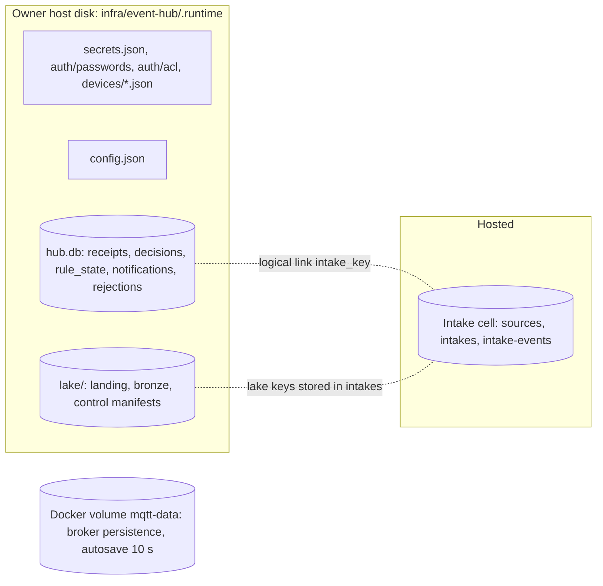

# 14 — Backup & DR

## ข้อมูลที่มีและอยู่ที่ไหน

| Data | Location | Backup found | Restore reality |
|---|---|---|---|
| `hub.db` | `.runtime/hub.db` (SQLite WAL, `synchronous=FULL`) | **none** in repo | lake-only restore loses cooldown / dedup state; spec: "lake-only restore needs explicit projection rebuild" — no rebuild command exists |
| Local lake | `.runtime/lake/` | **none** | immutable objects; manifest + checkpoint allow resuming a partial ingest (`ingest_payload`) |
| Secrets / ACL / device profiles | `.runtime/` 0600 | **none** | `setup` regenerates secrets only when `secrets.json` is missing → all devices need new credentials |
| Runtime config | `.runtime/config.json` | seed copy `infra/event-hub/config.json` in Git | `setup` copies the seed when missing (custom rules lost) |
| Broker queue | volume `mqtt-data` | none | autosave 10 s: crash before flush can lose un-acked messages (README) |
| Intake cell rows | platform-intake-api (Neon project `platform-intake-api` per its README) | covered by that service's pack | — |

- Retention: `operational`, เป้าหมาย 30 วัน, **ไม่มีการลบอัตโนมัติ** (README, central ingestion spec)
- RTO / RPO: **not defined** (ไม่มีในเอกสารของ repo)
- Recovery boundary ตาม README: "เหตุการณ์ที่มี verified manifest คือขอบเขตการกู้คืน"; HTTP sender ควรส่ง event เดิมซ้ำเมื่อได้ 503
- Nightly encrypted DB backups ของ prod baseline ไม่ครอบคลุมระบบนี้ (ไม่มี hosted DB; ops record prod-baseline-monitoring-backups ไม่กล่าวถึง event hub)

Sources: `infra/scripts/services/event_hub.py`, `infra/scripts/services/event_hub_transport.py` (`setup`), `infra/scripts/data_lake/ingest.py`, `infra/event-hub/compose.yml`,
`infra/event-hub/mosquitto.conf`, `infra/event-hub/README.md`, [event-hub-ingestion-spec.md](https://github.com/bookchaowalit/architecture-docs/blob/main/systems/ai-data/event-hub-ingestion-spec.md), `../../../platform-intake-api/README.md` (sibling repo).

## Open questions

- ต้องการ backup ของ `.runtime/` (hub.db + lake + secrets) หรือไม่ ในเมื่อเป็น pilot
- RTO / RPO ที่ยอมรับได้
- ใครทำการลบตาม retention 30 วัน และเมื่อไร
