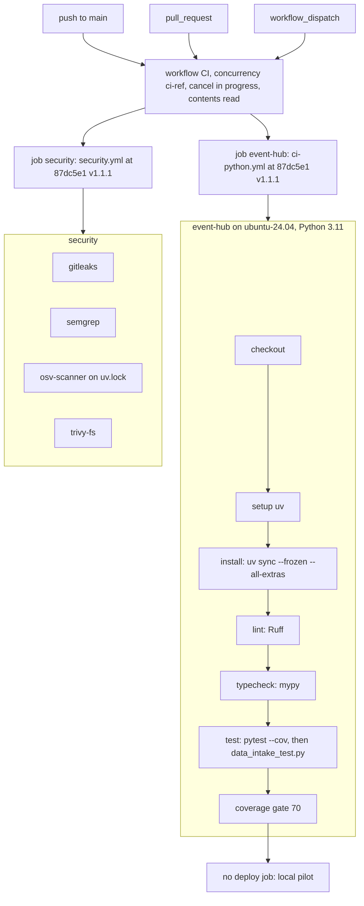

# 15 — CI/CD pipeline

- `event_hub_live_test.py` ไม่อยู่ใน CI (ต้องใช้ compose stack) — README, ci.yml comment
- Renovate เปิด PR dependency ทุกวันจันทร์ก่อน 9 โมง (Asia/Bangkok) และ lock maintenance วันที่ 1 ของเดือน
- Runs ล่าสุด (`gh run list`, 2026-11-04): 5 runs, 4 success, 1 failure (`4bc01cd`, `security / osv-scanner` step Scan, 2026-10-22)

Sources: `.github/workflows/ci.yml`, `renovate.json`, platform-ci-workflows `.github/workflows/ci-python.yml` และ `security.yml` ที่ commit `87dc5e1c7e0416886a6371d5a101bb2ccba38edd` (local clone),
`gh run list -R bookchaowalit/platform-event-hub-api`, `gh run view 39707588455`.
