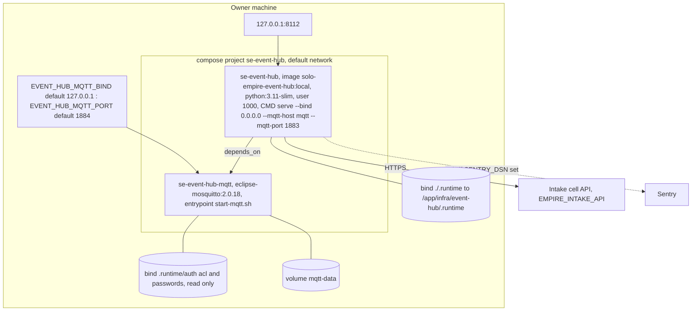

# 16 — Deployment

ไม่มี hosted deployment (registry `host: local`). "Deploy" = owner รัน `docker compose -f infra/event-hub/compose.yml up -d --build` บนเครื่องตนเอง.

| Setting | hub | mqtt |
|---|---|---|
| restart | `unless-stopped` | `unless-stopped` |
| limits | `mem_limit 512m`, `cpus 0.5` | `mem_limit 64m`, `cpus 0.25` |
| hardening | `no-new-privileges`, `cap_drop ALL` | `no-new-privileges` |
| healthcheck | python `urlopen http://127.0.0.1:8112/health` every 15 s, 3 retries | none |
| env | `EVENT_HUB_UID` / `EVENT_HUB_GID` only | `EVENT_HUB_MQTT_BIND` / `EVENT_HUB_MQTT_PORT` (host port) |

Host mode (dev): `docker compose up -d mqtt` แล้ว `event_hub.py serve` บน host (README).

Sources: `infra/event-hub/compose.yml`, `infra/event-hub/Dockerfile`, `infra/event-hub/start-mqtt.sh`, `infra/event-hub/README.md`,
solo-empire `repository-catalog/registries/online-systems.yaml` (`event-hub`), ops record: api-gateway-edge (2026-11-03) (owner `client.env` → gateway `/v1/intake`).

## Open questions

- **Container ต่อ Intake cell ได้อย่างไร**: `Hub.__init__` เรียก `open_cell_store("intake", "event-hub")` ซึ่งต้องมี `EMPIRE_INTAKE_API` และ token `event-hub`;
  compose ไม่ตั้ง env ทั้งสองและไม่ mount `~/.config/empire-platform` หรือ `<root>/.runtime/automation-tokens` — ถ้าไม่มี container จะ start ไม่ได้ (`ClientConfigError`)
- README ของ pilot ยังอ้าง `task event-hub` และ `infra/event-hub/requirements.txt` ของ solo-empire (ไม่มีใน repo นี้)
- `SENTRY_DSN` ตั้งไว้ที่ใดเมื่อรันจริง (compose ไม่ส่ง env นี้)
