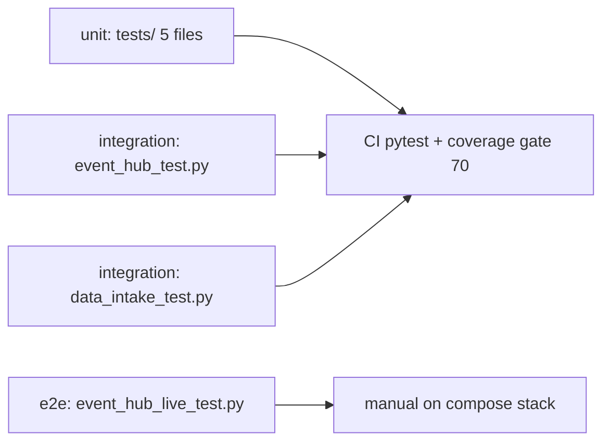

# 17 — Test coverage matrix

ระดับ: **unit** = `tests/*` (in-process, fakes), **integration** = `infra/tests/integrations/event_hub_test.py` (Hub + HTTP server + SQLite Intake double + local lake, offline)
และ `data_intake_test.py` (CLI ใน subprocess กับ SQLite), **e2e** = `event_hub_live_test.py` (compose stack จริง, manual).

| Feature | Unit | Integration | E2E (manual) | Gap |
|---|---|---|---|---|
| event.v1 validation | `test_event_validation.py` (12 tests) | `test_untrusted_shapes_rejected_without_raw_storage` | — | — |
| Config v1 rules | `test_config_rules.py` (10 tests) | `test_http_auth_origin_validation_and_config` | live test edits + restores config | — |
| Rule evaluation, cooldown, watermark | `test_rule_evaluation.py` (7 tests) | `test_normal_threshold_cooldown_and_late_order`, `test_stale_future_and_unit_mismatch_cannot_poison_watermark`, `test_independent_http_source_has_own_cooldown` | threshold / cooldown / late | — |
| Dedup + identity conflict | — | `test_duplicate_whitespace_and_conflicting_identity` | duplicate | — |
| Lake-first, verified Bronze | — | `test_exact_bytes_verified_intake_and_atomic_action`, `test_tampered_bronze_never_projects`, `test_history_reads_measurement_from_bronze` | — | — |
| Failure, rollback, retry | `test_sentry.py::test_an_unexpected_processing_error_*` | `test_lake_failure_blocks_actions_then_restart_recovers`, `test_partial_manifest_failure_resumes_identical_ingest`, `test_action_failure_rolls_back_cooldown_and_notifications`, `test_automatic_retry_is_bounded_and_manual_retry_recovers` | `--restart` | — |
| Source / rule pause, snapshot | — | `test_source_scoping_and_disabled_policy`, `test_removed_source_is_paused_in_existing_registry`, `test_rule_snapshot_stable_on_retry_and_disable_stops_actions` | — | — |
| HTTP auth, origin, body | — | `test_http_auth_origin_validation_and_config` | HTTP auth | `/session` cookie path, `/health` 503 path not named in a test |
| MQTT ack semantics | — | `test_mqtt_ack_only_after_completion_or_visible_rejection` (fake client) | MQTT ACL, broker | real broker only in manual e2e |
| Onboarding + ACL | — | `test_onboard_*` (3 tests) | — | — |
| Single writer lock | — | `test_single_runtime_writer` | — | — |
| Sentry opt-in + scrub | `test_sentry.py` (11 tests) | — | — | — |
| Image contents | `test_image_contents.py` (3 tests) | — | — | no `docker build` in CI |
| Intake CLI lifecycle | — | `data_intake_test.py` (script) | — | runs against SQLite, not the hosted Intake cell |
| Real Intake cell API | — | — | — | **no test** hits the hosted cell (`cell_store.ApiCellStore` HTTP paths) |

- Coverage source = `infra/scripts/services`, `infra/scripts/cli` (`pyproject.toml`); measured 72.25% on 2026-10-22 (`specs/001-l2-baseline/spec.md`)

Sources: `tests/*.py`, `infra/tests/integrations/*.py`, `pyproject.toml`, `.github/workflows/ci.yml`, `specs/001-l2-baseline/spec.md`.
