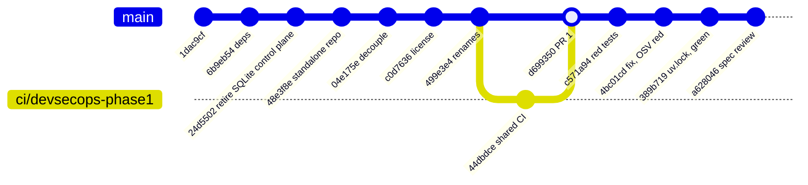
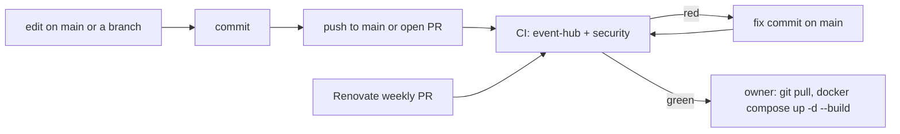

# 18 — Git & release workflow

ส่วนใหญ่ commit ตรงเข้า `main` (main-only, SPEC-001 "Main-only: yes"); มี PR เดียวคือ #1 (`ci/devsecops-phase1`). `main` ไม่มี branch protection / ruleset.
ไม่มี deploy trigger: "release" = owner pull แล้ว `docker compose up -d --build` เอง.

Sources: `git log origin/main`, `gh pr list --state all` (1 PR, merged 2026-10-17), `gh api .../branches/main/protection` (404 Branch not protected), `gh api .../rulesets` (`[]`),
`.github/workflows/ci.yml`, `renovate.json`, `specs/001-l2-baseline/spec.md`.

## Open questions

- ไม่มี tag / release; ต้องการ versioning ของ image หรือไม่
