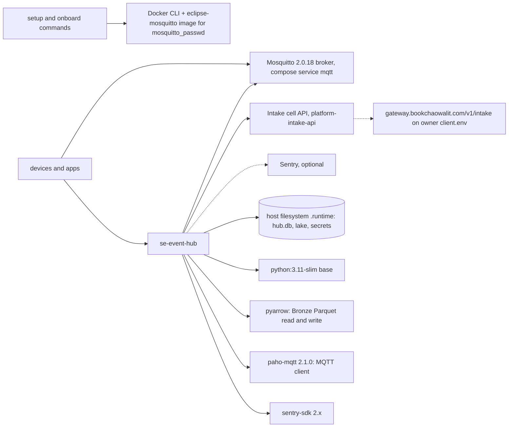

# 19 — Service dependency map (runtime)

| Dependency | Kind | Required for | Failure effect |
|---|---|---|---|
| Mosquitto | runtime service | MQTT ingest | `/health` 503 (worker not ready); HTTP ingest still works |
| Intake cell API | hosted API | every `receive` / `process` (`sync_sources`, enqueue … verify), startup | receipt `failed` with error class (e.g. `CellStoreError`), retried; startup fails without config |
| Local filesystem | storage | lake, hub.db, secrets | failure code, no action (lake-first) |
| Sentry | SaaS | error reporting | none (opt-in) |
| Docker CLI | host tool | `setup`, `onboard` password hashing | `mqtt_password_setup_failed` |
| No CDN, no external DB | — | — | — |

Sources: `pyproject.toml`, `uv.lock`, `infra/event-hub/requirements.lock`, `infra/event-hub/compose.yml`, `infra/event-hub/Dockerfile`,
`infra/scripts/services/event_hub.py`, `infra/scripts/services/event_hub_transport.py`, `infra/scripts/utils/cell_store.py`, ops record: api-gateway-edge (2026-11-03).
