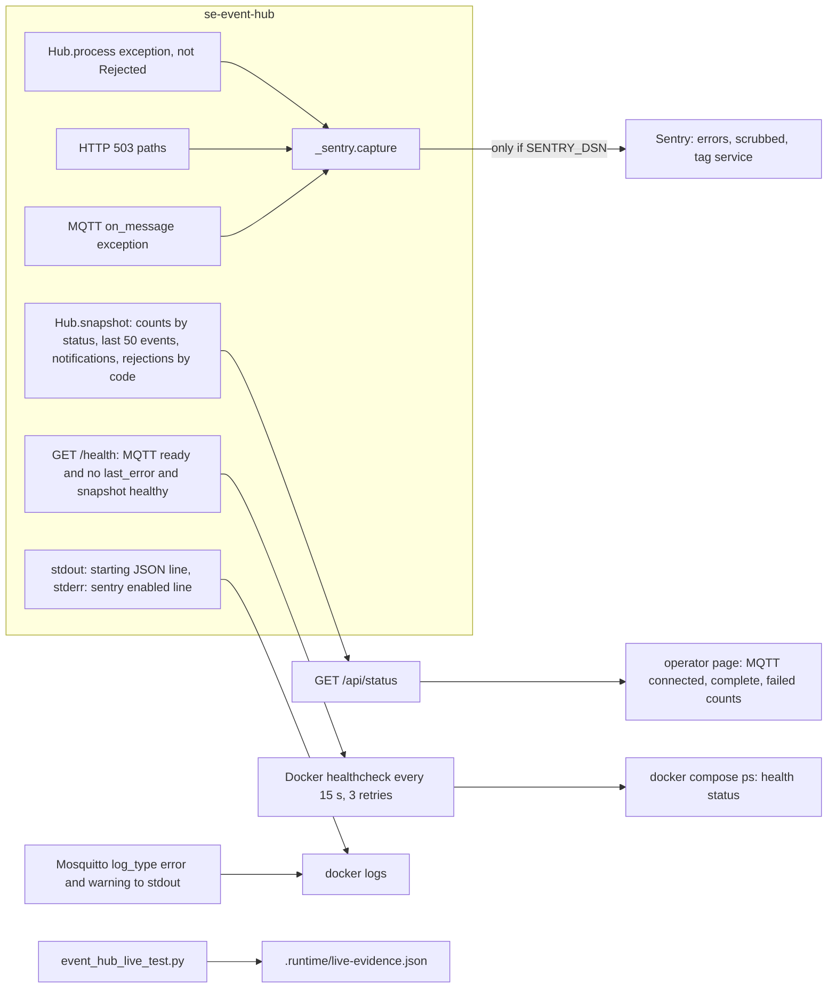

# 20 — Observability

| Signal | Source | Who watches |
|---|---|---|
| Receipt counts (`complete`, `failed`), rejection counts by code | `/api/status` (`Hub.snapshot`) | operator page (manual) |
| Health `healthy` / `degraded` | `/health`, Docker healthcheck | `docker compose ps` (manual) |
| Unexpected exceptions | Sentry (opt-in), `environment` = `SENTRY_ENVIRONMENT` default `production` | unknown — see open questions |
| Broker errors / warnings | Mosquitto stdout | `docker logs` |
| HTTP access log | **disabled** (`log_message` is a no-op) | — |
| Live E2E evidence | `.runtime/live-evidence.json` | operator |

ไม่มี: uptime Worker, heartbeat, PostHog, metrics endpoint, tracing (`traces_sample_rate=None`). ระบบไม่ได้ hosted จึงไม่อยู่ใน uptime monitor ของ prod baseline.

Sources: `infra/scripts/services/_sentry.py`, `infra/scripts/services/event_hub.py` (`snapshot`, `process`), `infra/scripts/services/event_hub_transport.py` (`get_response`, `log_message`, `on_message`, `run`),
`infra/event-hub/compose.yml` (healthcheck), `infra/event-hub/mosquitto.conf`, `infra/event-hub/index.html`, `PRODUCT.md` Measures.

## Open questions

- มี Sentry project สำหรับ event hub และ alert rule ไปที่ใด (repo ไม่มีข้อมูล; ops records ไม่กล่าวถึง event hub)
- PRODUCT.md Measures: "duplicate notifications per event and rule (target 0)" และ "time from receipt to complete" ยังไม่มี query/metric
