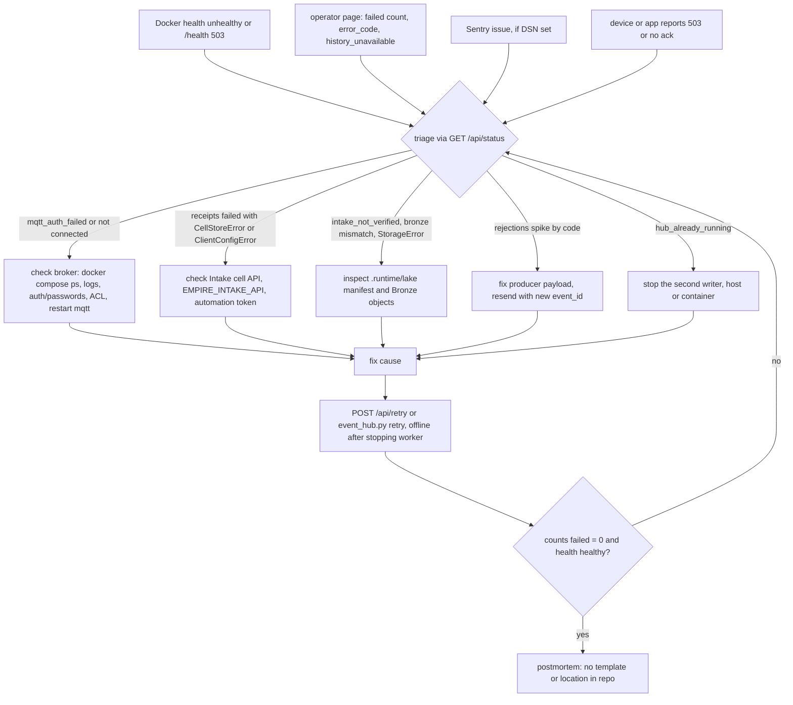

# 21 — Incident response

ช่องทางแจ้งเตือนที่มีจริงในโค้ด: Docker healthcheck (สถานะ `unhealthy` เท่านั้น ไม่ restart อัตโนมัติ), `/health` 503, หน้า operator (`failed` count, error_code),
Sentry (เฉพาะเมื่อตั้ง `SENTRY_DSN`). ไม่มี Telegram / pager ที่ผูกกับ repo นี้.

Sources: `infra/scripts/services/event_hub_transport.py` (`MQTTWorker`, `get_response`, `do_POST`), `infra/scripts/services/event_hub.py` (`Hub.__init__` `hub_already_running`, `process` codes, `retry`, `main`),
`infra/scripts/utils/cell_store.py` (`CellStoreError`), `infra/event-hub/README.md`, `infra/event-hub/compose.yml`.

## Open questions

- severity / ผู้รับผิดชอบ / ที่เก็บ postmortem สำหรับ pilot นี้
- Sentry alert ส่งไปช่องทางใด
