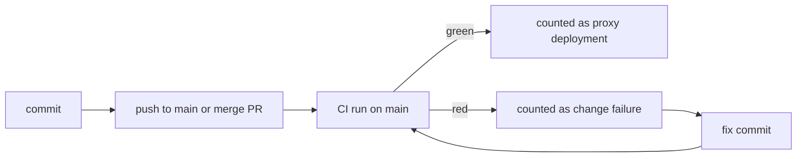

# 22 — DORA metrics

Window: 90 วันถึง 2026-11-04 (`--since=2026-08-06`). repo นี้ **ไม่มี deployment** (local pilot, ไม่มี deploy workflow, registry `host: local`)
จึงใช้ proxy: "deployment" = push ที่เข้า `main` แล้ว CI ทำงาน; "failure" = CI บน `main` แดง.

| Metric | How measured here | Value (2026-11-04) | Command |
|---|---|---|---|
| Deployment frequency | hosted deploys: none exist. Proxy: commits on `main`, and CI runs on `main` | **0 deploys**; 18 commits on 8 distinct days; 4 CI runs on `main` push (CI exists since 2026-10-17) | `git rev-list --count --since=2026-08-06 origin/main` → 18; `git log --since=2026-08-06 --format=%ad --date=short origin/main \| sort -u \| wc -l` → 8; `gh run list -R bookchaowalit/platform-event-hub-api --created ">=2026-08-06" --json event,headBranch,conclusion` |
| Lead time for changes | commit time → CI green on `main` (no deploy step) | d699350 32 s, 389b719 30 s, a628046 6 min 45 s, 4bc01cd → green via 389b719 15 min 34 s; median ≈ 3.6 min. PR #1: opened → merged 24 min | `git log -1 --format=%cI <sha>`; `gh run list --json headSha,createdAt,updatedAt`; `gh pr list --state all --json createdAt,mergedAt` |
| Change fail rate | red CI runs / CI runs on `main` push | **1 / 4 = 25 %** (`4bc01cd`, `security / osv-scanner` Scan) | `gh run list ... --json conclusion,event,headBranch`; `gh run view 39707588455 --json jobs` |
| Failed deployment recovery time | red `main` run finished → next green `main` run finished | **15 min** (01:46:43Z → 02:01:43Z, 2026-10-22) | `gh run list --json headSha,createdAt,updatedAt,conclusion` |
| Deployment rework rate | unplanned deploys that fix a previous deploy | **cannot compute**: no deployments exist | — |

หมายเหตุ: `updatedAt` ของ run ที่เรียก reusable workflows อาจจบก่อน job ลูก — ค่า lead time ระดับวินาทีจึงเป็นค่าต่ำสุดโดยประมาณ.
`4bc01cd` ตามด้วย `389b719` เป็นการแก้ OSV (dependency declaration) ไม่ใช่ rollback.

Sources: `git log origin/main`, `gh run list -R bookchaowalit/platform-event-hub-api`, `gh run view 39707588455`, `gh pr list -R bookchaowalit/platform-event-hub-api --state all`, `.github/workflows/ci.yml`.

## Open questions

- ถ้าจะวัด DORA จริง ต้องนิยาม "deploy" ของ pilot (เช่น `docker compose up --build` บนเครื่อง owner) และบันทึกเหตุการณ์นั้น
